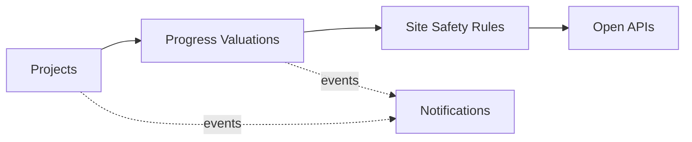

# Domain Model and Bounded Contexts

Ubiquitous language and context design (view VP-4). Domain-standard concepts are mapped
normatively in `../domain/domain-standards.md` (CR-5).

## Ubiquitous language (selected terms)

| Term | Meaning |
|---|---|
| **Project** | A road, bridge, building or dam under contract |
| **Certified progress** | Progress value certified against the contract, in minor units |
| **Progress certificate** | One certification of executed work value, by work type |
| **Safety standard (rule)** | A decision rule binding an activity type to crew and incident envelopes |
| **Construction asset** | A crane, excavator, mixer or scaffold unit in the fleet |
| **Site risk score** | A transparent 0-100 project risk score |

## Bounded contexts and invariants

### Projects — `project-service`
Infrastructure project registry. Lifecycle: `PLANNED` → transitions
start, complete. Worker personal data stays in adopter HR/safety systems; this core tracks projects, valuations, standards and assets. Site imagery and personal identifiers are out of scope by design; all data is synthetic.

### Progress Valuations — `progress-valuation-service`
Contract-value accounts per project and the certified progress certificates against them. **Invariant (ADR-0004): certified progress value on a project never exceeds its contract value — a progress certificate that would overrun it is rejected (422) and records nothing.** Consumption records are
append-only evidence; a rejected operation records nothing.

### Site Safety Rules — `site-safety-rules-service`
Decision rules binding activity types to crew-size and incident-rate envelopes. Only ACTIVE rules decide; evaluation order is by priority; every decision
is ALLOWED / DEGRADED / DENIED with the matched rule and a human-readable reason.

### Construction Assets — `construction-asset-service`
Fleet registry for site equipment.

### Notifications — `notification-service`
Delivery trail for audit; recipients are never logged.

## Context map

